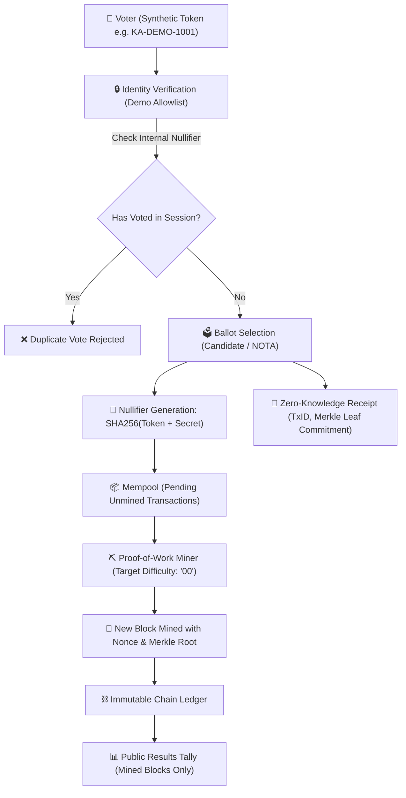

# 🗳️ ಕರ್ನಾಟಕ ವಿಧಾನಸಭಾ ಚುನಾವಣೆ ಬ್ಲಾಕ್‌ಚೈನ್ ಡೆಮೊ | Karnataka Legislative Assembly Blockchain Voting Demo

<p align="center">
  
</p>

<p align="center">
  <strong>ಒಂದು ಪಾರದರ್ಶಕ, ಶೈಕ್ಷಣಿಕ ನಾಗರಿಕ-ತಂತ್ರಜ್ಞಾನ (Civic-Tech) ಪ್ರದರ್ಶನ ಅಪ್ಲಿಕೇಶನ್</strong><br>
  <em>An educational, bilingual civic-tech demonstration of electronic ballot selection, zero-knowledge cryptographic receipts, and a transparent mock blockchain ledger.</em>
</p>

<p align="center">
  
  
  
  
  
  
</p>

---

## 📖 Overview | ಅವಲೋಕನ

This repository contains an open-source, civic-tech educational demonstration of a **Blockchain-Based Online Voting System** contextualized for the **Karnataka Legislative Assembly General Election (16th Assembly)**.

The system showcases how modern cryptographic primitives—such as **SHA-256 block hashing**, **Merkle trees**, **zero-knowledge receipts**, and **Proof-of-Work (PoW) consensus**—can record ballots immutably on a distributed ledger, while actively educating citizens about the inherent security and privacy trade-offs of electronic voting.

### Key Highlights:
- 🌐 **Kannada-First Bilingual Design:** Native Kannada (`kn`) interface paired with English (`en`), styled with high-fidelity typography and the official Karnataka Gandaberunda emblem.
- ⏱️ **Live IST Voting Window:** Real-time India Standard Time (`Asia/Kolkata`) countdown enforcing dynamic election states (`UPCOMING`, `OPEN`, `CLOSED`).
- 🧾 **Zero-Knowledge Voter Receipts:** Cryptographic proof of inclusion ($TxID$, Merkle leaf commitment, timestamp) without disclosing candidate choice or voter identity.
- ⛓️ **Interactive Ledger Explorer:** Real-time blockchain visualization displaying Genesis Block (`#0`), confirmed blocks, block difficulty, nonces, and an interactive **Mine Pending Block** feature.
- 📊 **Authentic Sourced Election Data:** Sourced directly from official **Election Commission of India (ECI)** and **Chief Electoral Officer (CEO), Karnataka** gazetted publications.

---

## 🏛️ Civic Trust Boundary & Ethical Disclaimers | ನಾಗರಿಕ ಗಡಿರೇಖೆ ಮತ್ತು ನಿರಾಕರಣೆ

> [!IMPORTANT]
> **ಶೈಕ್ಷಣಿಕ ಡೆಮೊ ಪ್ರದರ್ಶನ ಮಾತ್ರ / DEMONSTRATION PROTOTYPE ONLY**
> 
> * **Not an Official Service:** This application is strictly an educational simulation and is **NOT** affiliated with, authorized by, or endorsed by the Election Commission of India (ECI), the Chief Electoral Officer (CEO) Karnataka, or the Government of Karnataka.
> * **Zero Personal Data (No PII):** The application strictly uses synthetic demo tokens (e.g., `KA-DEMO-1001`). It **never** requests or stores real voter identity credentials such as EPIC voter numbers, Aadhaar, phone numbers, OTPs, or home addresses.
> * **Blockchain Limitations in Elections:** Remote online voting using blockchain is **not** election-ready for national democratic exercises. A blockchain ledger alone cannot resolve coercion resistance, ballot secrecy, client-device malware, or end-to-end democratic verifiability. In India, general elections strictly utilize standalone Electronic Voting Machines (EVMs) with Voter Verifiable Paper Audit Trails (VVPATs) inside isolated, supervised polling booths.

---

## 🏗️ Architecture & Cryptographic Flow

The system separates voter authorization from ballot recording using session nullifiers, preventing double voting while upholding constitutional ballot secrecy:



---

## 📁 Repository Structure

```text
Blockchain-based-online-voting-system-/
├── Templates/
│   ├── already_voted.html      # Notice for duplicate vote attempts
│   ├── index.html              # Main single-page interactive application
│   ├── invalid vote.html       # Legacy error screen
│   ├── invalid.html            # Invalid token / error template
│   └── success.html            # Successful ballot confirmation screen
├── static/
│   ├── css/
│   │   └── app.css             # Karnataka-themed responsive CSS styling
│   ├── images/                 # Sourced election symbols & Gandaberunda emblem
│   │   ├── BJP.jpg / bjp.png   # Bharatiya Janata Party symbol
│   │   ├── congress.png        # Indian National Congress symbol
│   │   ├── jds.png             # Janata Dal (Secular) symbol
│   │   ├── aap_broom.svg       # Aam Aadmi Party symbol
│   │   ├── bsp_elephant.svg    # Bahujan Samaj Party symbol
│   │   ├── krs_torch.svg       # Karnataka Rashtra Samithi symbol
│   │   ├── nota.svg            # NOTA symbol
│   │   └── karnataka_emblem.jpg# Karnataka State Gandaberunda Seal
│   └── js/
│       └── app.js              # Real-time UI controller, timer, & API bindings
├── app.py                      # Flask RESTful server & route handlers
├── blockchain.py               # Blockchain engine, SHA-256, Merkle tree, PoW
├── election_data.py            # Official ECI & CEO Karnataka sourced dataset
├── requirements.txt            # Python environment dependencies
└── README.md                   # Project documentation
```

---

## 🚀 Quick Start & How to Run | ಪ್ರಾಜೆಕ್ಟ್ ಚಲಾಯಿಸುವ ವಿಧಾನ

### Prerequisites
- **Python 3.10+** (Tested on Python 3.10, 3.11, 3.12, 3.14)
- **pip** package manager
- **Git**

### 1. Clone the Repository
```bash
git clone https://github.com/shambhavi0804/Blockchain-based-online-voting-system-.git
cd Blockchain-based-online-voting-system-
```

### 2. Create and Activate Virtual Environment
**On Windows (PowerShell):**
```powershell
python -m venv venv
.\venv\Scripts\activate
```

**On Linux / macOS:**
```bash
python3 -m venv venv
source venv/bin/activate
```

### 3. Install Dependencies
```bash
pip install -r requirements.txt
```

### 4. Start the Application
```bash
python app.py
```

### 5. Access in Browser
Open your web browser and navigate to:
```
http://127.0.0.1:5000/
```

---

## 🔑 Authorized Simulation Tokens | ಮಾದರಿ ಡೆಮೊ ಟೋಕನ್‌ಗಳು

Use any of the following synthetic simulation tokens to test voter authorization and ballot submission:

| Demo Token | Constituency | English Label | Kannada Label |
| :--- | :--- | :--- | :--- |
| `KA-DEMO-1001` | 160 - Sarvagnanagar | Verified Resident Demo Voter A | ಪರಿಶೀಲಿಸಿದ ನಿವಾಸಿ ಡೆಮೊ ಮತದಾರ ಅ |
| `KA-DEMO-1002` | 160 - Sarvagnanagar | Verified Senior Citizen Demo Voter B | ಪರಿಶೀಲಿಸಿದ ಹಿರಿಯ ನಾಗರಿಕ ಡೆಮೊ ಮತದಾರ ಬ |
| `KA-DEMO-1003` | 160 - Sarvagnanagar | Verified Youth Elector Demo Voter C | ಪರಿಶೀಲಿಸಿದ ಯುವ ಮತದಾರ ಡೆಮೊ ಮತದಾರ ಕ |
| `KA-DEMO-1004` | 219 - Varuna | Verified Rural Elector Demo Voter D | ಪರಿಶೀಲಿಸಿದ ಗ್ರಾಮೀಣ ಮತದಾರ ಡೆಮೊ ಮತದಾರ ಡ |
| `KA-DEMO-1005` | 173 - Jayanagar | Verified Urban Elector Demo Voter E | ಪರಿಶೀಲಿಸಿದ ನಗರ ಮತದಾರ ಡೆಮೊ ಮತದಾರ ಇ |

---

## ⏱️ Voting Window & Live Timer Configuration

Voting window parameters are configured in India Standard Time (`Asia/Kolkata` - IST) inside [election_data.py](election_data.py):

```python
VOTING_WINDOW = {
    "starts_at": "2026-10-14T07:00:00+05:30", # ISO-8601 timestamp in IST
    "ends_at":   "2026-10-16T18:00:00+05:30", # ISO-8601 timestamp in IST
    "timezone":  "Asia/Kolkata",
    "timezone_label": "ಭಾರತೀಯ ಪ್ರಮಾಣಿತ ಕಾಲಮಾನ (IST, UTC+05:30)"
}
```

### Election Window States:
1. **ತೆರೆದಿದೆ (OPEN):** Active countdown to closing time. Ballot submission is enabled.
2. **ಮುಂಬರುವ (UPCOMING):** Active countdown to opening time. Ballot submission is locked with an informational notice.
3. **ಮುಕ್ತಾಯಗೊಂಡಿದೆ (CLOSED):** Timer expired. Ballot submission is permanently disabled.

### Developer Overrides (For Testing):
To test different window states without modifying code, use the preview buttons in the Voting Window card or send a POST request:
- `POST /api/voting-window/override` with `{"state": "open"}`
- `POST /api/voting-window/override` with `{"state": "upcoming"}`
- `POST /api/voting-window/override` with `{"state": "closed"}`
- `POST /api/voting-window/override` with `{"state": "reset"}` (restores real-time timestamp calculation)

---

## 📊 Sourced Data Provenance | ಅಧಿಕೃತ ಮೂಲ ಮಾಹಿತಿ

Every political party, contesting candidate, serial number, and election symbol in this prototype is sourced from authentic gazetted publications of the **Election Commission of India (ECI)** and the **Chief Electoral Officer (CEO), Karnataka** for the **2023 Karnataka Legislative Assembly General Election (16th Assembly)**:

| Source Document | Issuing Authority | Primary Source | Verification |
| :--- | :--- | :--- | :--- |
| **Notification No. 56/2023/PPS-III** | Election Commission of India | [ECI Political Parties & Symbols](https://eci.gov.in/list-of-political-parties/) | Official Gazetted List |
| **Form 7A: List of Contesting Candidates** | Returning Officers / CEO Karnataka | [CEO Karnataka Form 7A](https://ceokarnataka.karnataka.gov.in/) | AC 160, AC 219, AC 173 |
| **ECI Symbol Orders & Specifications** | Election Commission of India | [ECI Election Symbols](https://eci.gov.in/election-symbol/) | Authorized Vector/Bitmap Assets |
| **Form 20: Final Result Sheets** | Election Commission of India | [ECI Results Portal](https://results.eci.gov.in/) | Verified Turnout & Counts |

### Supported Constituencies:
1. **160 - ಸರ್ವಜ್ಞನಗರ / Sarvagnanagar (Bengaluru Urban):** K. J. George (INC), Padmanabha Reddy (BJP), Mohammed Mustafa (JD(S)), Abdul Hannan (SDPI), Mohamed Ibrahim (AAP), S. Umashankar (KRS), Shivakumar (UPP), Vasanth Kumar E. (IND), NOTA.
2. **219 - ವರುಣಾ / Varuna (Mysuru):** Siddaramaiah (INC), V. Somanna (BJP), Dr. Bharathi Shankar N. L. (JD(S)), M. Krishnamurthy (BSP), Rajeshwari M. (IND), NOTA.
3. **173 - ಜಯನಗರ / Jayanagar (Bengaluru Urban):** C. K. Ramamurthy (BJP), Sowmya Reddy (INC), Kalegowda (JD(S)), Mohammed Rizwan (AAP), Kuldeep Kumar (IND), NOTA.

---

## 🖥️ Screen-by-Screen Tour

1. **Overview (ಮುನ್ನೋಟ):**
   - Karnataka Gandaberunda state emblem and bilingual election title.
   - Live Voting Window card with real-time IST countdown.
   - Official statistics (electors, valid polled votes, turnout %) and ECI governance framework table.
2. **Official Ballot (ಅಧಿಕೃತ ಮತಪತ್ರ):**
   - 7-point **Voting Precautions Panel** with bilingual security advice.
   - Voter demo verification with disposable quick tokens.
   - Sourced candidate roster formatted in official Form 7A serial order.
   - Accessible review confirmation modal before recording vote.
3. **Vote Receipt (ಮತದಾನ ರಶೀದಿ):**
   - Non-identifying cryptographic proof (TxID, timestamp, Merkle leaf commitment, mempool state).
   - **Zero-Knowledge Privacy:** Conspicuously **withholds candidate choice and voter identity** from the receipt to uphold ballot secrecy.
4. **Party Directory (ರಾಜಕೀಯ ಪಕ್ಷಗಳ ಕೋಶ):**
   - Searchable directory of 13+ ECI registered parties with National, State, and Registered Unrecognized badges.
   - Real-time indicator showing if a party fielded a candidate in the active constituency.
5. **Ledger Explorer (ಲೆಡ್ಜರ್ ಅನ್ವೇಷಕ):**
   - Real-time blockchain visualization displaying Genesis Block (`#0`) and confirmed mined blocks.
   - SHA-256 block hash, Merkle root, proof-of-work difficulty, and nonces.
   - Interactive **Mine Pending Block** button with proof-of-work simulation.
   - Aggregated election results bar chart compiled strictly from confirmed mined blocks.
6. **Privacy & Civic Limitations (ಗೌಪ್ಯತೆ ಮತ್ತು ಮಿತಿಗಳು):**
   - Plain-language civic briefing explaining the Secret Ballot paradox, the "Garbage In, Garbage Out" device security dilemma, and why supervised in-person EVM+VVPAT polling remains essential.

---

## 📡 RESTful API Reference

| Method | Endpoint | Description |
| :--- | :--- | :--- |
| `GET` | `/api/election-info` | Returns election metadata, voting window timestamps, precautions, and current IST time. |
| `POST` | `/api/voting-window/override` | Overrides the election window state (`open`, `upcoming`, `closed`, `reset`). |
| `GET` | `/api/constituencies` | Lists all supported Karnataka Assembly constituencies with turnout statistics. |
| `GET` | `/api/constituency/<code_or_id>` | Returns full details and contesting candidates for a specific constituency. |
| `GET` | `/api/parties` | Returns ECI registered political parties with optional constituency filter. |
| `GET` | `/api/demo-voters` | Lists synthetic demo tokens and their session voting status. |
| `POST` | `/api/verify-voter` | Verifies whether a token is in the demo allowlist and eligible to vote. |
| `POST` | `/api/vote` | Submits a ballot selection to the mempool and generates a zero-knowledge receipt. |
| `POST` | `/api/mine` | Mines pending mempool transactions into a new block using Proof-of-Work. |
| `GET` | `/api/blocks` | Returns the complete immutable blockchain ledger and current chain statistics. |
| `GET` | `/api/results` | Returns aggregated vote counts compiled strictly from confirmed mined blocks. |

---

## 🔒 Security & Cryptographic Principles

- **Demo Session Isolation:** No external cryptocurrency or live network connections; all operations run in a controlled local sandbox.
- **Session Nullifier:** Prevents double voting within the session using cryptographic nullifiers (`sha256(voter_token + session_secret)`).
- **Separation of Concerns:** Raw voter tokens and candidate choices are never published on the public ledger or embedded in URLs.
- **Merkle Tree Integrity:** Every block computes a Merkle root from transaction hashes, guaranteeing cryptographic immutability.
- **Accessible HTML5 & ARIA:** Semantic markup, `role="tablist"`, `role="tab"`, `role="dialog"`, keyboard accessibility, and visible focus indicators.

---

## 🤝 Contributing

Contributions, feedback, and suggestions for improving this civic-tech educational demonstration are welcome!

1. Fork the Project
2. Create your Feature Branch (`git checkout -b feature/AmazingFeature`)
3. Commit your Changes (`git commit -m 'Add some AmazingFeature'`)
4. Push to the Branch (`git push origin feature/AmazingFeature`)
5. Open a Pull Request

---

## 📄 License

This project is open-source under the [MIT License](https://opensource.org/licenses/MIT).
